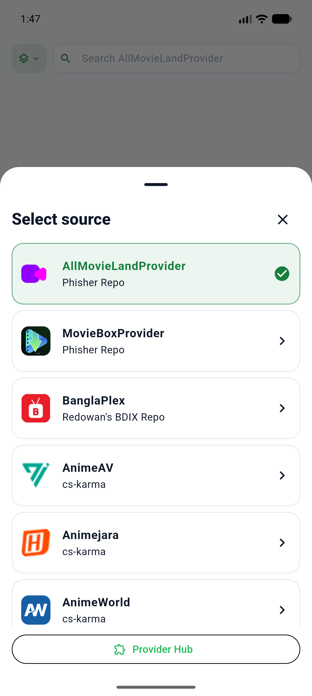
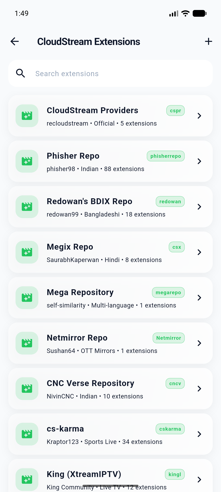
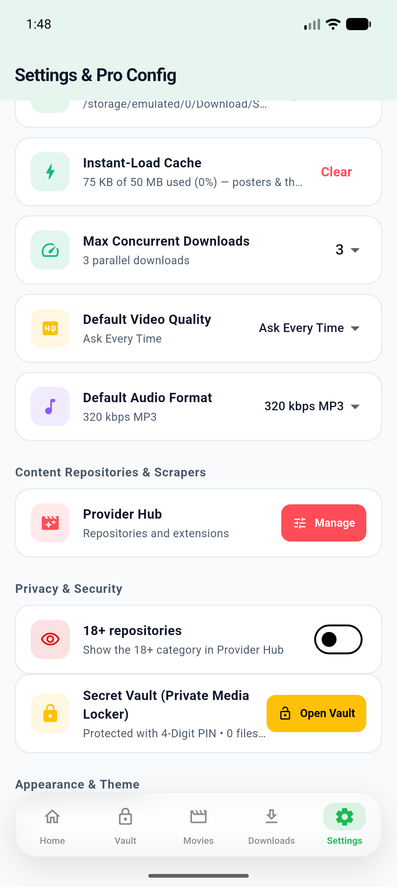
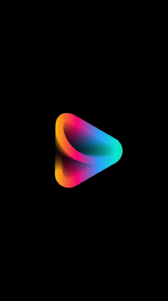

<p align="center">
  
</p>

# All in One — অ্যান্ড্রয়েড ভিডিও ডাউনলোডার, মুভি প্লেয়ার ও প্রাইভেট ভল্ট

**বাংলা** · [English](README.md) · [অ্যান্ড্রয়েড APK ডাউনলোড](https://github.com/shahinrezasifat1999/all-in-one/releases/latest)

**অল ইন ওয়ান** হলো Flutter-এ তৈরি একটি অ্যান্ড্রয়েড মিডিয়া অ্যাপ। সমর্থিত ওয়েবসাইট থেকে ভিডিও ডাউনলোড, একাধিক উৎস থেকে মুভি স্ট্রিমিং এবং ব্যক্তিগত ছবি ও ভিডিও সুরক্ষিত রাখার জন্য একই অ্যাপ ব্যবহার করতে পারবেন।

## এই সফটওয়্যার দিয়ে কী করতে পারবেন?

| ফিচার | কীভাবে কাজে লাগবে |
| --- | --- |
| **ওয়েব ও সোশ্যাল ভিডিও ডাউনলোড** | YouTube, Facebook, TikTok ও অন্যান্য সমর্থিত ওয়েবপেজ বা সরাসরি মিডিয়া লিংক থেকে ভিডিও সেভ করুন। অ্যাপের ব্রাউজার ওয়েবপেজে লোড হওয়া মিডিয়া শনাক্ত করতে পারে। |
| **মুভি স্ট্রিমিং ও প্লেয়ার** | অ্যাপের মুভি ক্যাটালগ ব্রাউজ করুন, উপলভ্য উৎস নির্বাচন করুন এবং বিল্ট-ইন প্লেয়ারে দেখুন। ক্যাটালগ ও প্লেব্যাক উৎসভেদে বদলাতে পারে। |
| **অফলাইনে ভিডিও দেখা** | ডাউনলোড করা মিডিয়া সাজিয়ে রাখুন এবং ডাউনলোড সম্পন্ন হলে ইন্টারনেট ছাড়াই চালান। |
| **প্রাইভেট ভল্ট ও ফিঙ্গারপ্রিন্ট** | ব্যক্তিগত মিডিয়া আলাদা ভল্টে রাখুন। PIN অথবা সমর্থিত অ্যান্ড্রয়েড ডিভাইসে ফিঙ্গারপ্রিন্ট ও অন্যান্য বায়োমেট্রিক পদ্ধতিতে ভল্ট আনলক করুন। |
| **GitHub থেকে অ্যাপ আপডেট** | চালুর সময় নতুন রিলিজ আছে কি না অ্যাপ পরীক্ষা করে। আপডেট প্রয়োজন হলে রিলিজের পরিবর্তনগুলো দেখায় এবং APK ডাউনলোডের লিংক খুলে দেয়। |

ব্রাউজার, ভিডিও ডাউনলোডার, মুভি প্লেয়ার ও প্রাইভেট ফোল্ডারের মধ্যে বারবার অ্যাপ বদলাতে হলে All in One একই জায়গা থেকে এই কাজগুলো করতে দেয়। ব্যবহারের অনুমতি আছে এমন মিডিয়াই ডাউনলোড বা স্ট্রিম করুন।

## অ্যাপের স্ক্রিনশট

| মুভির উৎস নির্বাচন | প্রোভাইডার হাব | পারমিশন ও ভল্ট সেটিংস |
| :---: | :---: | :---: |
|  |  |  |

<details>
<summary>অ্যানিমেটেড অ্যাপ ট্যুর দেখুন</summary>



</details>

## অ্যান্ড্রয়েডে ইনস্টল করুন

1. সর্বশেষ রিলিজের **Assets** থেকে APK ডাউনলোড করুন। [সর্বশেষ অ্যান্ড্রয়েড রিলিজ](https://github.com/shahinrezasifat1999/all-in-one/releases/latest)
2. APK খুলে অ্যান্ড্রয়েডের ইনস্টল নির্দেশনা অনুসরণ করুন। **Android 7.0 (API 24)** বা পরের সংস্করণ প্রয়োজন।
3. **All in One** খুলুন। ব্যক্তিগত মিডিয়া সুরক্ষিত করতে অ্যাপের প্রাইভেট ভল্ট সেট আপ করুন।

## প্রযুক্তি ও Flutter প্যাকেজ

| কাজ | প্যাকেজ ও প্রযুক্তি |
| --- | --- |
| অ্যাপ ইন্টারফেস ও স্টেট | Flutter, Dart, `provider`, `cupertino_icons`, `intl` |
| নেটওয়ার্ক ও রিলিজ আপডেট | `http`, `dio`, `pub_semver`, `url_launcher` |
| ব্রাউজার ও সোর্স রানটাইম | `webview_flutter`, `webview_win_floating`, `flutter_js` |
| ডাউনলোড ও মিডিয়া প্রসেসিং | `ytdlp_flutter`, `youtube_explode_dart`, `ffmpeg_kit_flutter_new_min`, youtubedl-android, yt-dlp, FFmpeg ও QuickJS |
| মিডিয়া প্লেব্যাক | `video_player`, `fvp` |
| স্টোরেজ, পারমিশন ও ভল্ট | `shared_preferences`, `path_provider`, `permission_handler`, `crypto` ও Android Biometric APIs |
| টেস্ট ও কোড যাচাই | `flutter_test`, `flutter_lints` |

প্যাকেজের সংস্করণ দেখুন [pubspec.yaml](pubspec.yaml) ও [pubspec.lock](pubspec.lock)-এ।

### সোর্স থেকে বিল্ড

Dart 3.13.5 বা পরবর্তী Dart 3 সংস্করণসহ Flutter, JDK 21 এবং Android SDK Platform 37 ব্যবহার করুন।

```sh
flutter pub get
flutter run
flutter build apk --release
```

## একক নির্মাতা ও রক্ষণাবেক্ষণকারী

**এস. এম. শাহিন রেজা সিফাত** এই অ্যাপের একমাত্র নির্মাতা ও রক্ষণাবেক্ষণকারী। তিনি গাজীপুর, বাংলাদেশের ফুল-স্ট্যাক সফটওয়্যার ডেভেলপার, ক্রিয়েটিভ ডিরেক্টর এবং Motion Work-এর প্রতিষ্ঠাতা।

সফটওয়্যার, ভিডিও প্রোডাকশন, অডিও ও ডিজিটাল মিডিয়ায় তাঁর ১২ বছরের বেশি অভিজ্ঞতা আছে। তিনি GTV-এর সাবেক সিনিয়র ভিডিও এডিটর, Bee Creation ও Sound Place-এর প্রতিষ্ঠাতা এবং Guardian Event Management & Media Corporation-এর প্রযুক্তি ও ক্রিয়েটিভ কার্যক্রমে নেতৃত্ব দেন। ব্যবহৃত তৃতীয় পক্ষের প্যাকেজগুলোর নিজস্ব নির্মাতা ও রক্ষণাবেক্ষণকারী রয়েছেন। [সম্পূর্ণ প্রোফাইল ও যোগাযোগ](README.md#developer)

- ইমেইল — [motionworkofficial@gmail.com](mailto:motionworkofficial@gmail.com)
- ওয়েবসাইট — [Motion Work](https://motionwork-tali.top)
- GitHub — [@shahinrezasifat1999](https://github.com/shahinrezasifat1999)
- YouTube — [@SHAHINREZASIFAT2025](https://www.youtube.com/@SHAHINREZASIFAT2025)
- Facebook — [Shahin Reza Sifat](https://www.facebook.com/Shahin.Reza.Sifat1997/)
- WhatsApp — [+8801766522499](https://wa.me/8801766522499)
