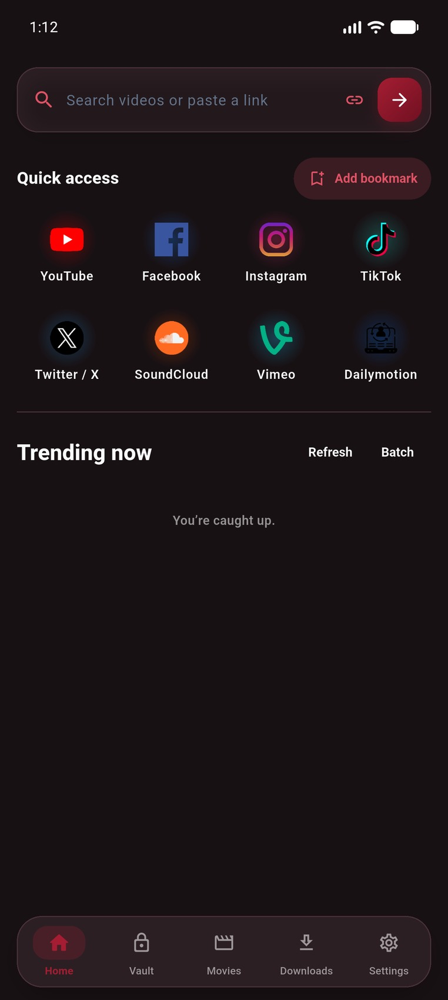
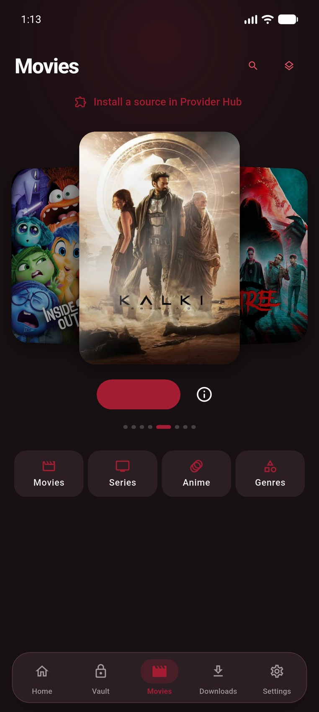
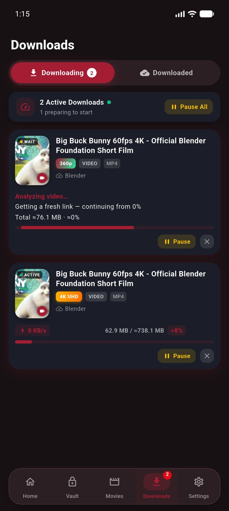
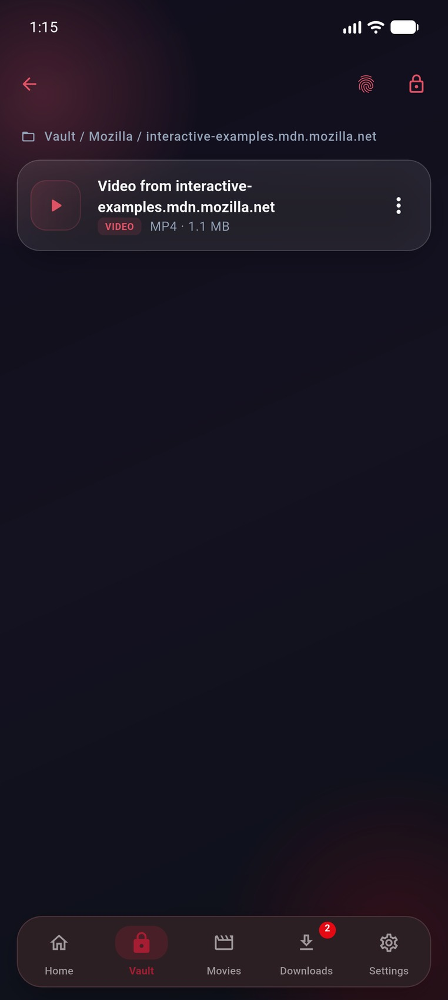
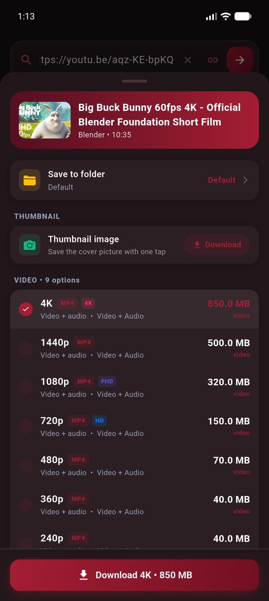
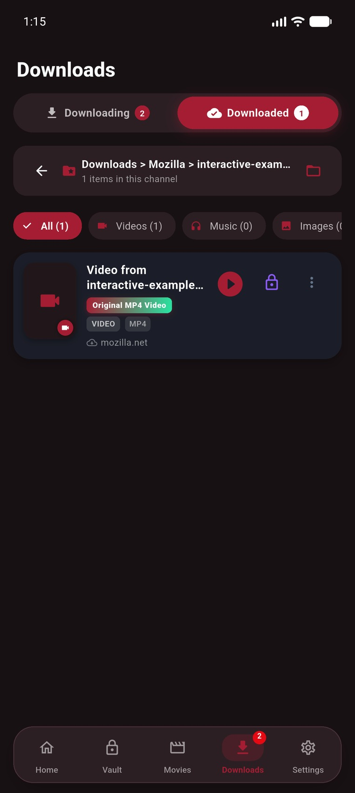

<p align="center">
  
</p>

<h1 align="center">All in One · Video Downloader, Movie Player &amp; Private Vault</h1>

<p align="center">Download web videos, stream movies from integrated sources, and keep personal media in a PIN- or fingerprint-protected Vault.</p>

<p align="center">
  <a href="https://github.com/shahinrezasifat/all-in-one/releases/download/v1.0.15/split-all-in-one-v1.0.15-arm64-v8a.apk"></a>
</p>

<p align="center">
  Android 7.0+ · Windows x64 · Linux x64 · <a href="#android-screenshots">See the app</a> · <a href="#download-and-install-on-android">Android builds</a> · <a href="#windows-and-linux-downloads">Desktop builds</a>
</p>

## What can you do with All in One?

| Feature | What you can do |
| --- | --- |
| **Web and social video downloader** | Download supported videos from YouTube, Facebook, TikTok, other webpages, and direct media links. The built-in browser can detect media loaded on a page. |
| **Multi-source movie streaming** | Browse integrated movie catalogs, choose an available source, and watch in the built-in player. Catalogs and playback vary by provider. |
| **Downloads and offline playback** | Browse downloaded movies by poster and play them with one tap. Open a series and switch among its downloaded seasons. Web videos stay grouped by website and channel. |
| **Audio and video controls** | Choose available video resolutions or audio-only formats, manage downloads, and play saved media with the built-in player. |
| **Private Vault** | Keep personal media in a dedicated vault with a PIN and optional fingerprint or supported biometric unlock on Android. |
| **GitHub release updates** | On Wi-Fi, Android automatically checks GitHub while the app is open. You can also check from Settings. A required update downloads inside the app and opens Android’s installation confirmation. |

All in One is useful if you regularly switch between a web browser, a video downloader, a movie player, and a private media folder. Download and stream media you have permission to use.

### Download a video or save the audio

Paste a link on **Home** to see the formats available for that video, or open a website in the in-app browser and use the download button when the app detects media. Choose a resolution such as **1080p or 4K** when offered, or choose an audio-only format. Follow the transfer in **Downloads** and play the completed file offline.

### Stream a movie or download a series

Open **Movies**, select a title and choose a playback source. If the provider offers a downloadable source, choose a quality and download the movie, an individual episode, or a season. Under **Downloads → Downloaded**, tap the movie poster to play the saved file. On a series poster, choose a downloaded season to see its episodes and file count.

### Keep personal media in the Vault

Open **Vault** and set a PIN. On supported Android devices, Settings can enable biometric unlock. Use a completed download's options to move it into the Vault.

## Android screenshots

Captured from All in One v1.0.8 on Android. Select an image to open it at full size.

| Home and web video tools | Movies and series | Active downloads | Private Vault |
| :---: | :---: | :---: | :---: |
| [](docs/media/android-home-v1.0.8.jpg) | [](docs/media/android-movies-v1.0.8.jpg) | [](docs/media/android-downloads-v1.0.8.jpg) | [](docs/media/android-vault-v1.0.8.jpg) |

| YouTube format picker | Completed website download |
| :---: | :---: |
| [](docs/media/android-youtube-formats-v1.0.8.jpg) | [](docs/media/android-completed-v1.0.8.jpg) |

The format picker and progress screen use Blender’s *Big Buck Bunny*. The completed download and Vault screens show Mozilla's public sample MP4. Movie sources and download formats depend on the provider and title.

## Download and install on Android

### Choose a build

| Android APK | Download size | Device |
| --- | ---: | --- |
| [ARM64 (arm64-v8a)](https://github.com/shahinrezasifat/all-in-one/releases/download/v1.0.15/split-all-in-one-v1.0.15-arm64-v8a.apk) | ~83 MB | Most modern Android phones and tablets |
| [ARM 32-bit (armeabi-v7a)](https://github.com/shahinrezasifat/all-in-one/releases/download/v1.0.15/split-all-in-one-v1.0.15-armeabi-v7a.apk) | ~83 MB | Older 32-bit ARM devices |
| [x86_64](https://github.com/shahinrezasifat/all-in-one/releases/download/v1.0.15/split-all-in-one-v1.0.15-x86_64.apk) | ~85 MB | Compatible Intel or AMD Android devices and emulators |
| [Universal](https://github.com/shahinrezasifat/all-in-one/releases/download/v1.0.15/all-in-one-v1.0.15.apk) | ~219 MB | Contains all three CPU architectures in one installer |

Each architecture-specific APK includes the app and the media engines for its CPU. The listed size is the APK download size. Installed storage usage can be higher.

1. Download the APK for your device. The main download button is for ARM64.
2. Open the APK and follow Android’s install prompts. **Android 7.0 or later (API 24+)** is required.
3. Open **All in One**. Set up the Private Vault if you want to protect personal media.

## Windows and Linux downloads

| Platform | Package | Run |
| --- | --- | --- |
| Windows 10/11 x64 | [Download Windows x64 package (.zip)](https://github.com/shahinrezasifat/all-in-one/releases/download/v1.0.13/all-in-one-v1.0.13-windows-x64.zip) | Extract the archive and run `snaptube_pure.exe` |
| Linux x64 | [Portable tar.gz](https://github.com/shahinrezasifat/all-in-one/releases/download/v1.0.13/all-in-one-v1.0.13-linux-x64.tar.gz) | Extract the archive and run `./snaptube_pure` |

The Windows app requires the Microsoft Visual C++ Runtime and WebView2 Runtime. [Microsoft Visual C++ Runtime](https://aka.ms/vc14/vc_redist.x64.exe) · [WebView2 Runtime](https://developer.microsoft.com/microsoft-edge/webview2/)

Linux was tested on Ubuntu 24.04 x64. The desktop bundle uses GTK 3, WebKitGTK 4.1, and JSON-GLib from the distribution. On Ubuntu 24.04, install them with `sudo apt install libgtk-3-0t64 libwebkit2gtk-4.1-0 libjson-glib-1.0-0`.

For desktop download and media conversion features that call external tools, install `yt-dlp` and `ffmpeg` and make them available on your system PATH. Android biometric unlock and mandatory APK updates are Android features.

## Built with Flutter and Dart

| Area | Packages and tools |
| --- | --- |
| UI and state | Flutter, Dart, `ChangeNotifier`, `cupertino_icons` |
| Networking and release updates | `http`, `dio`, `pub_semver`, `url_launcher` |
| Browser and source runtime | `webview_flutter`, vendored `webview_win_floating`, `flutter_js` |
| Downloads and media processing | Local `ytdlp_flutter`, `youtube_explode_dart`, `ffmpeg_kit_flutter_new_min`, youtubedl-android, yt-dlp, FFmpeg, and QuickJS |
| Playback | `video_player`, `fvp` |
| Storage and permissions | `shared_preferences`, `path_provider`, `permission_handler`, `crypto`, and Android’s native biometric APIs |
| Testing and linting | `flutter_test`, `flutter_lints` |

See pinned dependencies in [pubspec.yaml](pubspec.yaml) and [pubspec.lock](pubspec.lock). The local plugins are in [packages](packages).

### Build from source

Use Flutter with Dart 3.13.5 or later in the Dart 3 series, **JDK 21** (required by the Android Gradle plugin's lint tooling) and Android SDK Platform 37. The app bytecode targets Java 17. Release builds require the release keystore configured in `android/key.properties`.

```sh
flutter pub get
flutter run
flutter build apk --release
```

For a new APK release, increase both the version and Android build number in `pubspec.yaml`, sign with the same key used for the previous release, and attach the universal APK as `all-in-one-v<version>.apk` to a GitHub Release tagged `v<version>`. The updater also recognizes compatible architecture-specific APKs and a single-module bundletool archive named `all-in-one-v<version>.apks` with the base and configuration splits. [GitHub Releases](https://github.com/shahinrezasifat/all-in-one/releases)

## Developer

**S. M. Shahin Reza Sifat** created and maintains All in One as its sole app developer. The third-party packages listed above are maintained by their respective authors.

Full-Stack Software Developer, Creative Director & Founder of Motion Work

Gazipur, Bangladesh

Sifat has over 12 years of multidisciplinary experience across software development, multimedia production, and digital media. He previously served as Senior Video Editor at GTV (Gazi TV).

He is the Founder, CEO & Director of **Motion Work** (Production House & Digital Agency), the Founder of **Bee Creation** (Creative Media & Web Series) and **Sound Place** (Audio & Voice-over Studio), and leads tech and creative operations at **Guardian Event Management & Media Corporation**.

### What I do

| Expertise | Services and tools |
| --- | --- |
| Software & App Development | Full-stack web, Android, cross-platform and desktop apps, custom utilities, and audio plugins. Flutter, Laravel, PHP, Node.js, Python, MySQL, and SQLite. |
| Video Production & Post-Production | Video direction, cinematography, professional video editing, color grading, and motion graphics. DaVinci Resolve Studio, Adobe Premiere Pro, and After Effects. |
| Audio & Sound Engineering | Commercial audio production, SFX mixing, sound design, and music production. |
| Graphic & UI/UX Design | Brand identity, UI/UX design, and commercial graphics. Photoshop and Illustrator. |

### Contact & social links

- Email — [motionworkofficial@gmail.com](mailto:motionworkofficial@gmail.com)
- Website — [Motion Work](https://motionwork-tali.top)
- GitHub — [@shahinrezasifat](https://github.com/shahinrezasifat)
- YouTube — [@SHAHINREZASIFAT2025](https://www.youtube.com/@SHAHINREZASIFAT2025)
- Facebook — [Shahin Reza Sifat](https://www.facebook.com/Shahin.Reza.Sifat1997/)
- WhatsApp — [+8801766522499](https://wa.me/8801766522499)
