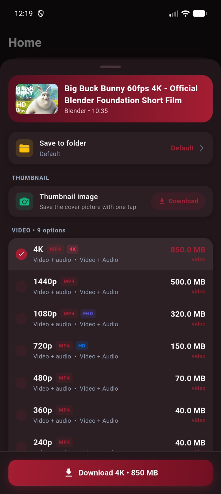
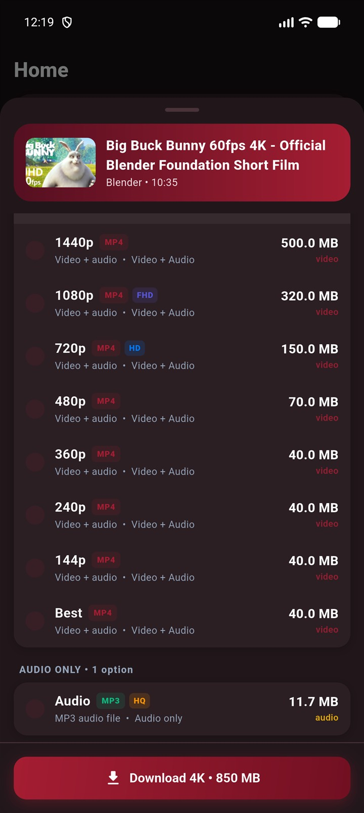
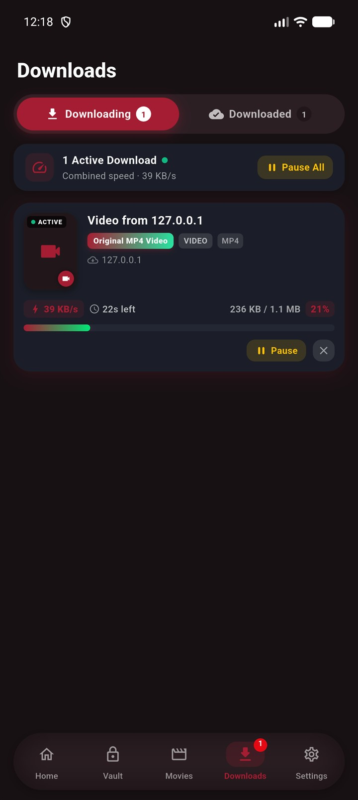
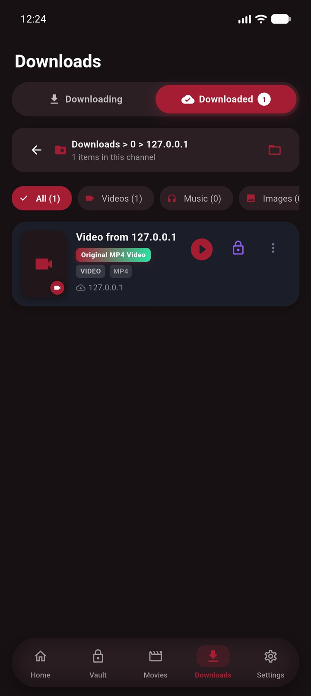
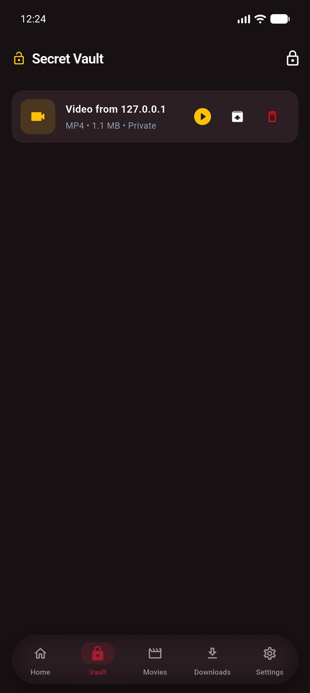
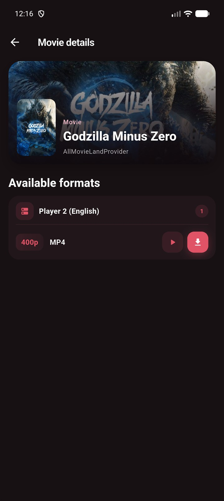

<p align="center">
  
</p>

# All in One

[Download Android APK](https://github.com/shahinrezasifat1999/all-in-one/releases/latest)

All in One is a Flutter Android app for downloading videos from supported websites, streaming movies from integrated providers, and keeping personal media in a PIN- or fingerprint-protected vault. Use the built-in browser to detect downloadable media, choose a source in the movie player, and organize saved files in one app.

## What can you do with All in One?

| Feature | What you can do |
| --- | --- |
| **Web and social video downloader** | Download supported videos from YouTube, Facebook, TikTok, other webpages, and direct media links. The built-in browser can detect media loaded on a page. |
| **Multi-source movie streaming** | Browse integrated movie catalogs, choose an available source, and watch in the built-in player. Catalogs and playback vary by provider. |
| **Downloads and offline playback** | Keep saved media organized and play completed downloads offline. |
| **Private Vault** | Keep personal media in a dedicated vault with a PIN and optional fingerprint or supported biometric unlock on Android. |
| **GitHub release updates** | The Android app checks for newer releases at startup. A required update shows release notes and opens the APK download. |

All in One is useful if you regularly switch between a web browser, a video downloader, a movie player, and a private media folder. Download and stream media you have permission to use.

## Android screenshots

Captured in the Android app. Click an image to inspect the full screenshot.

| YouTube 4K picker | YouTube audio options | Active download |
| :---: | :---: | :---: |
| [](docs/media/youtube-4k-formats.jpg) | [](docs/media/youtube-audio-formats.jpg) | [](docs/media/active-download-progress.jpg) |

| Completed download | Demo video in the Vault | Movie download option |
| :---: | :---: | :---: |
| [](docs/media/completed-demo-download.jpg) | [](docs/media/demo-video-in-vault.jpg) | [](docs/media/movie-source-download.jpg) |

The YouTube images show the formats listed for that video. The download and Vault images use the same demo MP4 served from the emulator's local test server. Movie sources and available resolutions vary by title and provider.

[View the Home screen with its video link field, platform shortcuts, and trending feed](docs/media/home-video-discovery.jpg).

<details>
<summary>Play the animated app tour</summary>


</details>

## Download and install on Android

1. Open the latest release and download the APK from **Assets**. [Latest Android release](https://github.com/shahinrezasifat1999/all-in-one/releases/latest)
2. Open the APK and follow Android’s install prompts. **Android 7.0 or later (API 24+)** is required.
3. Open **All in One**. Set up the Private Vault from the app if you want to protect personal media.

## Built with Flutter and Dart

| Area | Packages and tools |
| --- | --- |
| UI and state | Flutter, Dart, `provider`, `cupertino_icons`, `intl` |
| Networking and release updates | `http`, `dio`, `pub_semver`, `url_launcher` |
| Browser and source runtime | `webview_flutter`, vendored `webview_win_floating`, `flutter_js` |
| Downloads and media processing | Local `ytdlp_flutter`, `youtube_explode_dart`, `ffmpeg_kit_flutter_new_min`, youtubedl-android, yt-dlp, FFmpeg, and QuickJS |
| Playback | `video_player`, `fvp` |
| Storage and permissions | `shared_preferences`, `path_provider`, `permission_handler`, `crypto`, and Android’s native biometric APIs |
| Testing and linting | `flutter_test`, `flutter_lints` |

See pinned dependencies in [pubspec.yaml](pubspec.yaml) and [pubspec.lock](pubspec.lock). The local plugins are in [packages](packages).

### Build from source

Use Flutter with Dart 3.13.5 or later in the Dart 3 series, JDK 21, and Android SDK Platform 37.

```sh
flutter pub get
flutter run
flutter build apk --release
```

For a new APK release, increase both the version and Android build number in `pubspec.yaml`, sign with the same key used for the previous release, and attach the universal APK to a GitHub Release tagged `v<version>`. [GitHub Releases](https://github.com/shahinrezasifat1999/all-in-one/releases)

## Developer

**S. M. Shahin Reza Sifat** created and maintains All in One as its sole app developer. The third-party packages listed above are maintained by their respective authors.

Full-Stack Software Developer, Creative Director & Founder of Motion Work

Gazipur, Bangladesh

Sifat has over 12 years of multidisciplinary experience across software development, multimedia production, and digital media. He previously served as Senior Video Editor at GTV (Gazi TV).

He is the Founder, CEO & Director of **Motion Work** (Production House & Digital Agency), the Founder of **Bee Creation** (Creative Media & Web Series) and **Sound Place** (Audio & Voice-over Studio), and leads tech and creative operations at **Guardian Event Management & Media Corporation**.

### What I do

| Expertise | Services and tools |
| --- | --- |
| Software & App Development | Full-stack web, Android, cross-platform and desktop apps, custom utilities, and audio plugins. Flutter, Laravel, PHP, Node.js, Python, MySQL, and SQLite. |
| Video Production & Post-Production | Video direction, cinematography, professional video editing, color grading, and motion graphics. DaVinci Resolve Studio, Adobe Premiere Pro, and After Effects. |
| Audio & Sound Engineering | Commercial audio production, SFX mixing, sound design, and music production. |
| Graphic & UI/UX Design | Brand identity, UI/UX design, and commercial graphics. Photoshop and Illustrator. |

### Contact & social links

- Email — [motionworkofficial@gmail.com](mailto:motionworkofficial@gmail.com)
- Website — [Motion Work](https://motionwork-tali.top)
- GitHub — [@shahinrezasifat1999](https://github.com/shahinrezasifat1999)
- YouTube — [@SHAHINREZASIFAT2025](https://www.youtube.com/@SHAHINREZASIFAT2025)
- Facebook — [Shahin Reza Sifat](https://www.facebook.com/Shahin.Reza.Sifat1997/)
- WhatsApp — [+8801766522499](https://wa.me/8801766522499)
